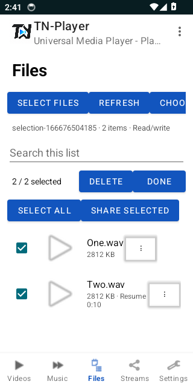
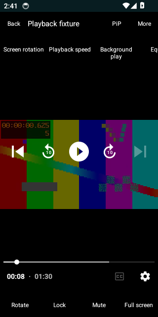
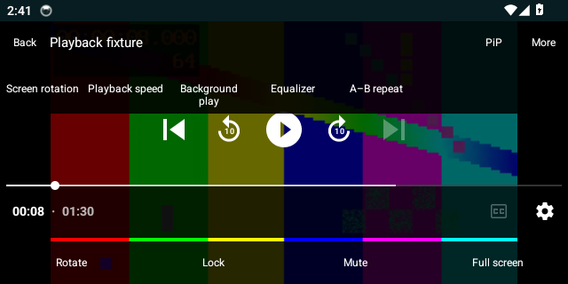
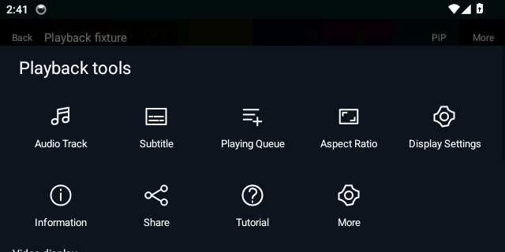

# TN-Player native screens

Android 14 emulator captures from source `8abcd28b95983d7eebad2ece18701e65b16f3070` on 17 October 2026. These are real app screens at 320 dp portrait / 640 dp landscape, not mockups. Media names, test pattern and selection files are temporary test fixtures, not a shipped demo library. Panels scroll vertically and shortcut rows scroll horizontally.

## Select files individually or all together

Long-press a file or tap Select files, then tap individual files/check boxes. The selection bar includes the count, Delete, Done, Select all and Share selected. Delete opens a permanent-deletion confirmation; Android can additionally require system approval.

## Portrait playback

Saved-position playback, seek/time controls, top shortcuts, Rotate, Lock, Mute and Full screen. PiP and More remain available at the top.

## Landscape playback

The compact landscape layout retains time, seek, previous/next and playback controls. Orientation changes retain the service's active item and position.

## Playback tools

Audio Track, Subtitle, Playing Queue, Aspect Ratio, Display Settings, Information, Share, Tutorial and More. Scroll for Video display, Show shortcuts, Customise items and Close tools. Display settings include mirror, vertical flip and night display; shortcut customization controls which actions appear above the video.

## Folder counts and navigation

Counts refer to accessible indexed media. Select a folder to browse its matching files.

## View, layout and sort

Scroll for the remaining sort choices, ordering, Fields and Advanced controls. Cancel discards the draft; Done persists it.

## Me hub

App Theme, full Settings, Custom Pop-up Play, View & layout and Help continue below the shortcut card. Private Folder, Local Network and Recycle Bin are explicitly unavailable. Cloud Drive uses installed Android document providers.

