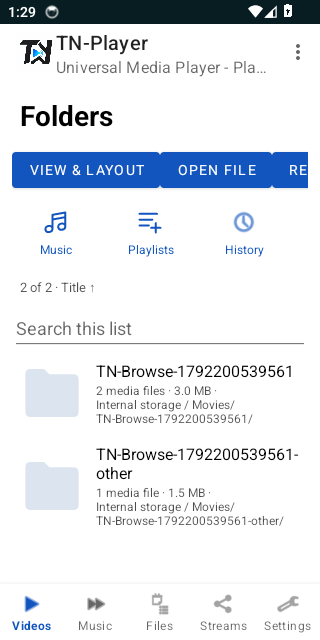
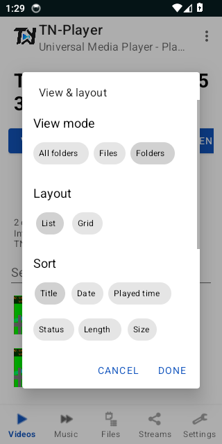
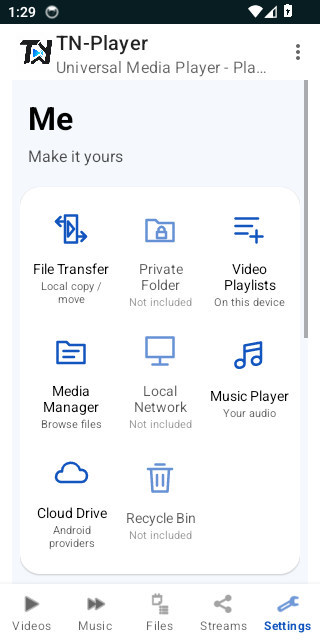

# Folder browser and settings UI

Native Android 14 emulator captures from source `703cbcc313b21ec61984bd8fb70d2daa3e922b5d` (17 October 2026). The small 320 dp emulator intentionally exercises a compact phone layout. Longer panels and the Me hub scroll vertically; shortcut rows scroll horizontally.

The two TN-Browse folders and video files are temporary instrumentation fixtures, deleted after testing. They are not shipped as a demo library in the app. Real users see their own accessible indexed media after granting permission.

## Folder counts and navigation

## View, layout and sort

The panel scrolls to the remaining sort choices, ordering, Fields and Advanced controls. Cancel discards the draft; Done persists it.

## Me hub

App Theme, full Settings, Custom Pop-up Play, View & layout and Help continue below the shortcut card. Private Folder, Local Network and Recycle Bin are explicitly unavailable. Cloud Drive uses installed Android document providers, not a built-in sync client.

